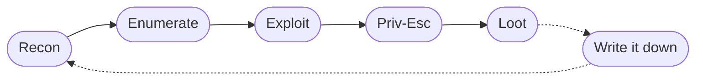

> [!abstract] README
> tunnelcat here! This is a collection of my offensive-security focused writeups covering web security, everything from Active Directory to the cloud, CTFs/challenge machines, courses, and more to come.
>
> Use the search (top-left) to jump to a technique, or pick a collection below.

> [!quote] Method over memory
> Tools change, processes don't. Enumerate harder and always keep notes.
## Collections

> [!example]+ [HackTheBox](hackthebox) · 40+ machines
> Full writeups for retired HTB boxes, from `nmap` to `root.txt`, with the enumeration and priv-esc steps spelled out.
> Highlights: [[HTB_blue]] · [[HTB_lame]] · [[HTB_forest]] · [[HTB_active]] · [[HTB_armageddon]]

> [!bug]+ [PentesterLab](pentesterlab) · 80+ exercises
> Crypto attacks (CBC-MAC, ECB), code and command execution, and a long list of real CVEs reproduced from scratch.
> Highlights: [[From SQL Injection to Shell]] · [[API to Shell]] · [[CVE-2014-6271_Shellshock]] · [[GraphQL Introspection]]

> [!danger]+ [Web Security - PortSwigger](web-security---portswigger) · 30+ topics
> Notes from the Web Security Academy: injection, access control, auth, XSS, SSRF, and deserialization.
> Highlights: [[SQL Union Attacks]] · [[XSS Intro]] · [[SSRF]] · [[OAuth 2.0]] · [[Insecure Deserialization]]

> [!tip]+ [TryHackMe](tryhackme) · rooms & walkthroughs
> Guided rooms and red-team fundamentals, with a lot of Active Directory and post-exploitation.
> Highlights: [[Attacking Kerberos]] · [[Attacktive Directory]] · [[Nmap in Detail]] · [[Post-Exploitation Basics]]

> [!info]+ [flAWS.cloud](flaws.cloud) · challenges
> The classic AWS misconfiguration challenge: open S3 buckets, leaked keys, and public snapshots.
> Highlights: [[Level 1_ Enumerating S3 Buckets]] · [[Level 3_ AWS Secret Key Disclosure (Git)]]

